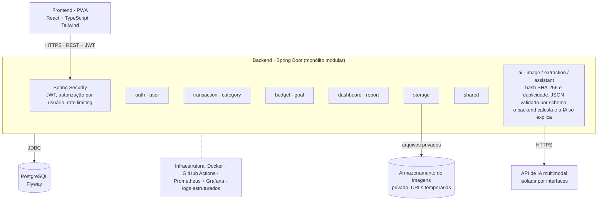

## 5. Arquitetura

O FinTrack AI é um monólito modular: um único deploy Spring Boot dividido em módulos com fronteiras claras. Isso mantém a operação simples agora e permite extrair módulos no futuro, se for necessário.



O frontend só fala com a API REST; a API é a única que acessa o banco, o armazenamento e o provedor de IA. O backend valida cada resposta da IA e nada é salvo sem confirmação do usuário.

**Estrutura de pacotes do backend**

```text
com.fintrack
├── auth
├── user
├── transaction
├── category
├── budget
├── goal
├── dashboard
├── report
├── ai
│   ├── image
│   ├── extraction
│   └── assistant
├── storage
└── shared
```

**Estrutura do repositório**

```text
fintrack-ai/
├── frontend/
├── backend/
├── infrastructure/
│   ├── docker/
│   └── monitoring/
├── docs/
│   ├── architecture/   (ADRs)
│   ├── requirements/
│   ├── database/
│   └── api/
├── scripts/
├── .github/workflows/
├── docker-compose.yml
└── README.md
```

**Regras de arquitetura**

- Cada módulo segue controller → service → repository e expõe DTOs; entidades JPA nunca saem pela API.
- Um módulo usa outro apenas por sua interface pública (service), nunca pelo repository alheio.
- Cálculos financeiros usam `BigDecimal` e SQL no backend; a IA nunca calcula.
- Provedores de IA ficam atrás de interfaces (`VisionExtractor`, `FinancialAdvisor`), o que permite trocá-los e testar com *fakes*.
- Todo acesso a dados filtra pelo `userId` do token, mesmo com um único usuário hoje.
- Falha da IA não derruba o sistema: o cadastro manual continua funcionando.

