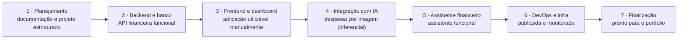

## 9. Decisões tecnológicas e roadmap

A stack combina o que o projeto precisa (dados financeiros relacionais, IA multimodal, PWA) com o que você quer aprofundar: Java e Spring Boot.

**Stack**

| Camada | Tecnologia | Justificativa |
| --- | --- | --- |
| Frontend | React + TypeScript | Ecossistema amplo, tipagem e manutenção |
| Estilização | Tailwind CSS | Interface responsiva |
| PWA | Vite PWA | Instalação no celular |
| Backend | Java + Spring Boot | Backend robusto; aprofunda APIs REST, POO e persistência |
| Segurança | Spring Security | Controle de acesso |
| Banco | PostgreSQL | Dados relacionais e consistência |
| Migrações | Flyway | Versionamento do banco |
| IA | API multimodal | Interpretação de imagens e consultoria |
| Testes (backend) | JUnit + Mockito | Regras de negócio e segurança |
| Testes (frontend) | Vitest | Interface e lógica de tela |
| Containers | Docker | Ambiente reproduzível |
| CI/CD | GitHub Actions | Automação de testes e deploy |
| Monitoramento | Prometheus + Grafana | Observabilidade |

**Decisões arquiteturais (ADRs a registrar em `docs/architecture`)**

| ADR | Decisão | Motivo | Alternativa descartada |
| --- | --- | --- | --- |
| 001 | Monólito modular | Menos complexidade operacional; evolui por módulos | Microsserviços |
| 002 | Web + PWA | Um código para celular e PC | App nativo Android/iOS |
| 003 | Valores em `NUMERIC`/`BigDecimal` | Precisão financeira | `FLOAT`/`DOUBLE` |
| 004 | Cálculos no backend; IA só interpreta | Resultados verificáveis e testáveis | IA calculando a partir do histórico |
| 005 | Confirmação humana antes de salvar | A IA pode errar; confiança é estimativa | Salvamento automático |
| 006 | Provedor de IA atrás de interface | Troca e testes com *fakes* | Acoplar ao SDK de um provedor |
| 007 | Imagens em armazenamento privado com URL temporária | Privacidade dos comprovantes | Arquivos públicos ou no banco |

**Roadmap**

Sete fases em sequência, fora de escala, com total estimado de 8 a 12 semanas (algumas horas por semana). Cada fase termina com algo que roda e pode ser verificado antes de seguir; a Fase 4 é o diferencial do produto.

| Fase | Escopo | Critério de aceite (proposto) |
| --- | --- | --- |
| 1 · Planejamento | Requisitos, repositório, arquitetura, modelo de dados, protótipos de tela | Este documento aprovado; README e ADRs iniciais; protótipos das telas principais |
| 2 · Backend e banco | Spring Boot, PostgreSQL + Flyway, entidades, API REST, autenticação e autorização, testes | Migrações rodam do zero; CRUD de transações pela API; teste de isolamento entre usuários passa; CI verde |
| 3 · Frontend e dashboard | React + TypeScript, interface responsiva, dashboard, histórico, filtros, integração | Login, lançamento manual e dashboard funcionam no celular e no PC |
| 4 · Integração com IA | API multimodal, upload, extração estruturada, revisão, duplicidade | Print de Pix vira transação só após confirmação; extrato com várias linhas funciona; duplicata é sinalizada |
| 5 · Assistente | Chat, consultas financeiras, resumo mensal, recomendações, orçamentos e alertas | Respostas coincidem com os números calculados pelo backend; alerta de orçamento dispara |
| 6 · DevOps e infra | Docker Compose, CI/CD, deploy, monitoramento, logs estruturados, backup | `docker compose up` sobe tudo; merge na `main` publica; restauração de backup testada |
| 7 · Finalização | Testes de integração e segurança, UX, documentação da API, README, vídeo | Checklist de segurança (seção 8) cumprido; README e demonstração em vídeo prontos |

**Como trabalhar com o Claude Code.** Uma tarefa pequena por vez, sempre neste ciclo: implementar, rodar os testes, revisar código e segurança, fazer commit. O agente não deve construir o sistema inteiro de uma vez, e este documento é a referência que ele consulta a cada tarefa.

**Questões em aberto**

- Qual API multimodal usar (custo por imagem, política de retenção de dados, qualidade com comprovantes brasileiros).
- Onde hospedar (provedor de nuvem e custo mensal aceitável) e qual armazenamento de imagens (compatível com S3 ou disco privado).
- PDF entra já no MVP ou apenas imagens?
- Moeda única (BRL) no MVP, ou suporte a outras moedas?
