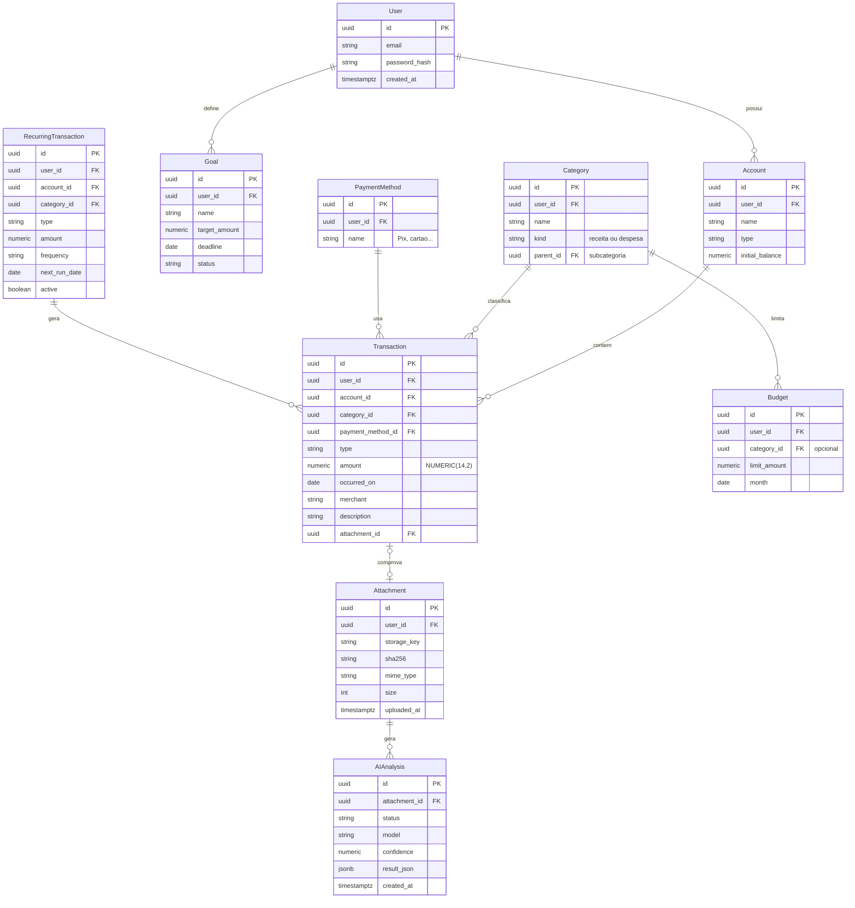

## 6. Modelo de dados

O PostgreSQL guarda 10 entidades, com `Transaction` no centro. Todos os atributos são um ponto de partida para o Flyway, não um esquema final. Todas as tabelas de dados levam `user_id`: o isolamento por usuário vale sempre.

Um usuário tem várias contas, e cada conta tem várias transações. Uma transação tem uma categoria, uma forma de pagamento e, opcionalmente, um comprovante; cada comprovante pode gerar uma ou mais análises de IA (mais de uma permite reprocessar a imagem).

**Decisões de modelagem**

- Valores monetários em `NUMERIC(14,2)` no banco e `BigDecimal` no Java; nunca `FLOAT` ou `DOUBLE`.
- Chaves primárias em UUID, sem IDs sequenciais expostos.
- `occurred_on` é uma `DATE` (o dia do gasto, sem fuso); `created_at` e `uploaded_at` são `TIMESTAMPTZ` em UTC.
- `user_id` em todas as tabelas de dados, com índices como `(user_id, occurred_on)` e `(user_id, category_id)`.
- O saldo da conta é calculado (saldo inicial + receitas − despesas), não armazenado, para não divergir do histórico.
- `amount` é sempre positivo (`CHECK amount > 0`); o sinal vem de `type` (receita ou despesa).
- `Attachment` tem unicidade em `(user_id, sha256)`, que sustenta a detecção de imagem duplicada.
- `AIAnalysis` guarda o JSON validado, o status (pendente, revisada, confirmada, descartada), o modelo e os tokens usados; a imagem fica só no armazenamento.
- Subcategorias usam `parent_id` na própria tabela `Category`.
- Migrações versionadas em `V1__...sql`, `V2__...sql`, e nenhuma alteração manual no banco.

