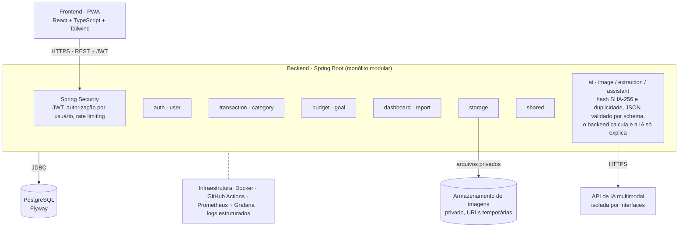
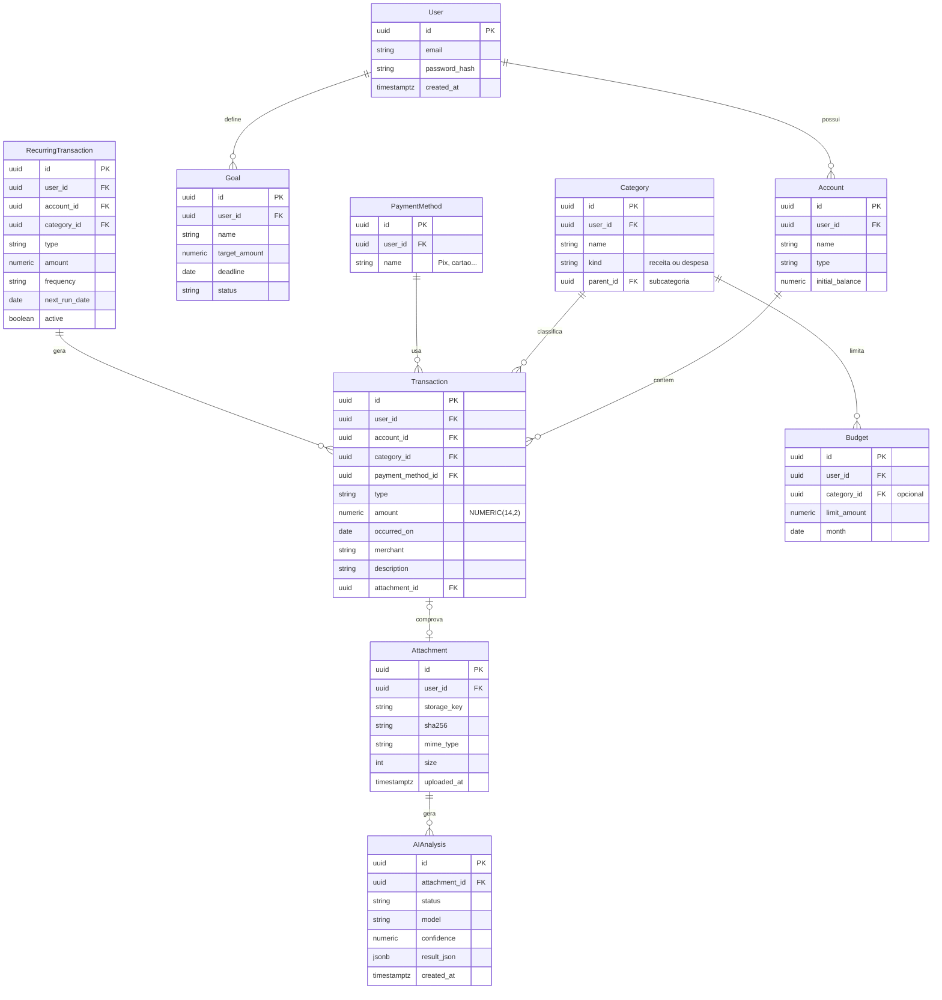
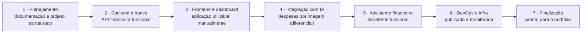

# FinTrack AI — Documento Técnico Inicial

Versão de 06/11/2026. Os diagramas abaixo estão em Mermaid (renderizam no GitHub e em editores Markdown com suporte).

## 1. Visão geral e escopo

O FinTrack AI é um gerenciador financeiro pessoal (web responsiva + PWA) em que o usuário envia imagens de comprovantes e a IA extrai as transações para revisão e confirmação. Este documento é a referência única para o Claude Code implementar o projeto em tarefas pequenas e verificáveis.

**Objetivos**

1. Eliminar o cadastro manual de cada despesa.
2. Centralizar receitas, despesas e movimentações.
3. Dar uma visão clara da situação financeira (dashboard).
4. Usar IA para identificar padrões e oportunidades de economia.
5. Sincronizar dados entre celular e computador.

**Decisões de produto**

| Decisão | Definição |
| --- | --- |
| Público | Uso pessoal, com arquitetura pronta para multiusuário |
| Plataformas | Web responsiva + PWA |
| Registro principal | Imagem analisada por IA, sempre com confirmação |
| Registro alternativo | Manual (correções e gastos sem comprovante) |
| IA | Visão (extração) + consultoria (assistente) |
| Cálculos financeiros | Sempre no backend; a IA apenas interpreta os resultados |
| Backend | Java + Spring Boot, monólito modular |
| Banco | PostgreSQL |
| Infraestrutura | Docker + CI/CD (GitHub Actions) |

**Fora do escopo inicial:** Open Finance, sincronização de cartões, app nativo Android/iOS, investimentos, previsões avançadas, notas fiscais complexas, microsserviços e Kubernetes.

O MVP está concluído quando for possível: acessar por celular e PC, logar, enviar um print, corrigir e confirmar os dados extraídos, ver a transação no dashboard, consultar gastos por período, conversar com o assistente, rodar tudo com Docker, publicar por CI/CD e monitorar em produção.

## 2. Requisitos funcionais

São 28 requisitos em seis módulos. "MVP" = obrigatório na primeira versão utilizável; "P2" = fase posterior.

| ID | Módulo | Requisito | Prioridade |
| --- | --- | --- | --- |
| RF-01 | Autenticação | Cadastro, login, logout e renovação de sessão (JWT + refresh token) | MVP |
| RF-02 | Financeiro | CRUD de transações (receita/despesa) com data, valor, descrição, estabelecimento, categoria e forma de pagamento | MVP |
| RF-03 | Financeiro | Categorias e subcategorias, com um conjunto padrão e personalização pelo usuário | MVP |
| RF-04 | Financeiro | Contas financeiras (ex.: carteira, conta corrente) com saldo calculado | MVP |
| RF-05 | Financeiro | Histórico com filtros por período, categoria, tipo, conta e texto | MVP |
| RF-06 | Financeiro | Despesas recorrentes (mensal/semanal) com geração automática de lançamentos | P2 |
| RF-07 | Captura IA | Upload de imagem (JPEG, PNG, WebP; PDF opcional) com validação de tipo e tamanho | MVP |
| RF-08 | Captura IA | Extração estruturada: tipo, valor, data, estabelecimento, categoria, pagamento, descrição, confiança | MVP |
| RF-09 | Captura IA | Suporte a imagens com várias transações (extratos): uma lista de itens, cada um confirmável separadamente | MVP |
| RF-10 | Captura IA | Tela de revisão: editar qualquer campo extraído antes de salvar | MVP |
| RF-11 | Captura IA | Nunca salvar sem confirmação explícita do usuário | MVP |
| RF-12 | Captura IA | Campos não identificados ficam vazios e sinalizados; nada é presumido | MVP |
| RF-13 | Captura IA | Detecção de duplicidade: hash da imagem e transação similar (valor + data + estabelecimento) | MVP |
| RF-14 | Captura IA | Comprovante original vinculado à transação confirmada | MVP |
| RF-15 | Assistente | Chat que responde perguntas sobre os gastos usando dados consultados pelo backend | MVP |
| RF-16 | Assistente | Resumo mensal gerado pela IA a partir de números calculados pelo backend | MVP |
| RF-17 | Assistente | Análises proativas: aumento de gastos, recorrências, padrões, sugestões de economia, projeção até o fim do mês | P2 |
| RF-18 | Dashboard | Saldo, receitas, despesas, gastos do mês, comparação com o mês anterior | MVP |
| RF-19 | Dashboard | Distribuição por categoria e últimas movimentações | MVP |
| RF-20 | Orçamentos | Limite mensal geral e por categoria, com progresso | MVP |
| RF-21 | Orçamentos | Alertas ao se aproximar do limite (ex.: 80% e 100%) | P2 |
| RF-22 | Metas | Metas de economia com valor-alvo, prazo e progresso | P2 |
| RF-23 | Relatórios | Relatório mensal e anual | P2 |
| RF-24 | Relatórios | Evolução de receitas/despesas e comparação entre categorias | P2 |
| RF-25 | Relatórios | Exportação em CSV e PDF | P2 |
| RF-26 | PWA | Instalável no celular, layout responsivo, upload pela câmera/galeria | MVP |
| RF-27 | Plataforma | Todos os dados isolados por usuário | MVP |
| RF-28 | Plataforma | Exclusão de conta e dos dados/imagens do usuário | P2 |

Regra transversal: a IA nunca cria, altera ou exclui dados por conta própria; todo lançamento passa por ação explícita do usuário.

## 3. Requisitos não funcionais

Os alvos abaixo são metas iniciais para um projeto pessoal; devem ser revisados após medição real.

| ID | Categoria | Requisito | Meta / verificação |
| --- | --- | --- | --- |
| RNF-01 | Segurança | Senhas com hash seguro (BCrypt ou Argon2) | Nenhuma senha em texto puro no banco ou logs |
| RNF-02 | Segurança | JWT de curta duração + refresh token com rotação | Access token ≤ 15 min |
| RNF-03 | Segurança | Autorização por usuário em toda consulta | Teste automatizado: usuário A não acessa dados de B |
| RNF-04 | Segurança | Segredos e chaves de API fora do repositório | Variáveis de ambiente; varredura de segredos no CI |
| RNF-05 | Privacidade | Imagens em armazenamento privado, acesso por URL temporária | URL expira em minutos |
| RNF-06 | Privacidade | Logs sem dados financeiros sensíveis | Revisão de logs; mascaramento de valores e textos |
| RNF-07 | Privacidade | O assistente recebe só os dados necessários à pergunta | Nunca o histórico completo |
| RNF-08 | Desempenho | Respostas da API (exceto IA) rápidas | p95 < 500 ms em consultas comuns |
| RNF-09 | Desempenho | Extração de uma imagem | Resposta em até ~15 s, com indicador de progresso |
| RNF-10 | Integridade | Valores monetários em NUMERIC(14,2), nunca float/double | Revisão de código + teste de arredondamento |
| RNF-11 | Integridade | Migrações versionadas (Flyway) | Banco reproduzível do zero |
| RNF-12 | Uploads | Limite de tamanho e tipo; validação pelo conteúdo, não só pela extensão | Ex.: máx. 10 MB; JPEG/PNG/WebP |
| RNF-13 | Resiliência | Rate limiting nos endpoints de login, upload e chat | Respostas 429 testadas |
| RNF-14 | Resiliência | Falha da API de IA não impede o cadastro manual | Degradação graciosa com mensagem clara |
| RNF-15 | Qualidade | Cobertura de testes nas regras de negócio e segurança | JUnit/Mockito/Testcontainers; Vitest no frontend |
| RNF-16 | Operação | Ambiente reproduzível e deploy automatizado | `docker compose up` e pipeline CI/CD |
| RNF-17 | Operação | Métricas e logs estruturados; backup diário do banco | Prometheus/Grafana; restauração testada |
| RNF-18 | Usabilidade | Interface responsiva, uso confortável no celular | Testes em telas de 360 px a desktop |
| RNF-19 | Manutenibilidade | Decisões arquiteturais registradas | ADRs em `docs/architecture` |

## 4. Casos de uso

O ator principal é o **Usuário** autenticado; a **IA** e o **Armazenamento** são sistemas de apoio acionados pelo backend.

| ID | Caso de uso | Resumo |
| --- | --- | --- |
| UC-01 | Cadastrar e autenticar | Cria conta, faz login, renova e encerra a sessão |
| UC-02 | Lançar transação manualmente | Preenche o formulário e salva; o dashboard é atualizado |
| UC-03 | **Registrar transação por imagem** | Fluxo principal, detalhado abaixo |
| UC-04 | Consultar histórico | Filtra por período, categoria, tipo e conta |
| UC-05 | Ver dashboard | Saldo, totais, comparativo mensal, categorias, resumo da IA |
| UC-06 | Conversar com o assistente | Faz perguntas e recebe respostas baseadas em dados reais |
| UC-07 | Definir orçamento | Limite mensal geral ou por categoria; acompanha o consumo |
| UC-08 | Criar meta de economia | Valor-alvo, prazo e progresso |
| UC-09 | Gerar e exportar relatório | Mensal ou anual, em CSV ou PDF |

**UC-03 — Registrar transação por imagem**

1. O usuário envia uma imagem (print de Pix, extrato, comprovante ou compra).
2. O backend valida tipo, tamanho e conteúdo, calcula o hash e verifica se a mesma imagem já foi enviada.
3. A imagem é guardada em armazenamento privado e enviada à API de IA multimodal. (Decisão de 09/11: extração local por padrão; ver `specs/SPEC-decisoes-fase-4.md`.)
4. A IA devolve JSON estruturado (uma ou mais transações); o backend valida campos, tipos e valores.
5. O backend marca possíveis duplicatas e campos não identificados.
6. O usuário revisa, edita e confirma cada transação (ou descarta).
7. Somente após a confirmação, a transação é gravada e vinculada ao comprovante; o dashboard é atualizado.

*Fluxos alternativos:* imagem ilegível ou sem transação → aviso e opção de lançamento manual; duplicata detectada → usuário decide manter ou descartar; falha da API de IA → mensagem clara e cadastro manual disponível; extrato com várias linhas → confirmação individual ou em lote.

**UC-06 — Conversar com o assistente:** o backend identifica a intenção e o período da pergunta, calcula os números necessários e envia apenas esse resultado à IA, que explica tendências e sugere ações sem recalcular valores.

## 5. Arquitetura

O FinTrack AI é um monólito modular: um único deploy Spring Boot dividido em módulos com fronteiras claras. Isso mantém a operação simples agora e permite extrair módulos no futuro, se for necessário.



O frontend só fala com a API REST; a API é a única que acessa o banco, o armazenamento e o provedor de IA. O backend valida cada resposta da IA e nada é salvo sem confirmação do usuário.

**Estrutura de pacotes do backend**

```text
com.fintrack
├── auth
├── user
├── transaction
├── category
├── budget
├── goal
├── dashboard
├── report
├── ai
│   ├── image
│   ├── extraction
│   └── assistant
├── storage
└── shared
```

**Estrutura do repositório**

```text
fintrack-ai/
├── frontend/
├── backend/
├── infrastructure/
│   ├── docker/
│   └── monitoring/
├── docs/
│   ├── architecture/   (ADRs)
│   ├── requirements/
│   ├── database/
│   └── api/
├── scripts/
├── .github/workflows/
├── docker-compose.yml
└── README.md
```

**Regras de arquitetura**

- Cada módulo segue controller → service → repository e expõe DTOs; entidades JPA nunca saem pela API.
- Um módulo usa outro apenas por sua interface pública (service), nunca pelo repository alheio.
- Cálculos financeiros usam `BigDecimal` e SQL no backend; a IA nunca calcula.
- Provedores de IA ficam atrás de interfaces (`VisionExtractor`, `FinancialAdvisor`), o que permite trocá-los e testar com *fakes*.
- Todo acesso a dados filtra pelo `userId` do token, mesmo com um único usuário hoje.
- Falha da IA não derruba o sistema: o cadastro manual continua funcionando.

## 6. Modelo de dados

O PostgreSQL guarda 10 entidades, com `Transaction` no centro. Todos os atributos são um ponto de partida para o Flyway, não um esquema final. Todas as tabelas de dados levam `user_id`: o isolamento por usuário vale sempre.



Um usuário tem várias contas, e cada conta tem várias transações. Uma transação tem uma categoria, uma forma de pagamento e, opcionalmente, um comprovante; cada comprovante pode gerar uma ou mais análises de IA (mais de uma permite reprocessar a imagem).

**Decisões de modelagem**

- Valores monetários em `NUMERIC(14,2)` no banco e `BigDecimal` no Java; nunca `FLOAT` ou `DOUBLE`.
- Chaves primárias em UUID, sem IDs sequenciais expostos.
- `occurred_on` é uma `DATE` (o dia do gasto, sem fuso); `created_at` e `uploaded_at` são `TIMESTAMPTZ` em UTC.
- `user_id` em todas as tabelas de dados, com índices como `(user_id, occurred_on)` e `(user_id, category_id)`.
- O saldo da conta é calculado (saldo inicial + receitas − despesas), não armazenado, para não divergir do histórico.
- `amount` é sempre positivo (`CHECK amount > 0`); o sinal vem de `type` (receita ou despesa).
- `Attachment` tem unicidade em `(user_id, sha256)`, que sustenta a detecção de imagem duplicada.
- `AIAnalysis` guarda o JSON validado, o status (pendente, revisada, confirmada, descartada), o modelo e os tokens usados; a imagem fica só no armazenamento.
- Subcategorias usam `parent_id` na própria tabela `Category`.
- Migrações versionadas em `V1__...sql`, `V2__...sql`, e nenhuma alteração manual no banco.

## 7. Módulo de IA

A IA tem dois papéis separados: **extrair** dados de imagens e **interpretar** números já calculados. Ela nunca grava dados nem faz contas financeiras.

**Contrato de extração.** A resposta deve ser JSON validado pelo backend (schema rígido; resposta fora do schema é rejeitada). Como uma imagem pode ter várias transações, o formato é uma lista:

```json
{
  "transactions": [
    {
      "type": "EXPENSE",
      "amount": 85.90,
      "date": "2026-11-05",
      "merchant": "Supermercado",
      "category": "FOOD",
      "payment_method": "PIX",
      "description": "Compras de mercado",
      "confidence": 0.96,
      "missing_fields": [],
      "needs_review": false
    }
  ],
  "image_quality": "GOOD"
}
```

Regras: campo não identificado vem `null` e entra em `missing_fields`; o modelo não presume dados ausentes; `confidence` é uma estimativa do modelo, não garantia; o backend converte `amount` para `BigDecimal` e valida data, enums e categoria existente.

**Duplicidade (duas camadas)**

| Camada | Como detecta | Resultado |
| --- | --- | --- |
| Imagem | Hash SHA-256 do arquivo por usuário | Avisa que a imagem já foi enviada |
| Transação | Mesmo valor + data próxima + estabelecimento similar | Marca como possível duplicata na revisão |

A decisão final é sempre do usuário.

**Assistente financeiro.** O backend (1) classifica a pergunta, (2) executa consultas e cálculos em SQL/serviços, (3) envia à IA apenas os resultados agregados e (4) devolve a explicação. A IA não recebe o histórico completo e deve citar apenas números fornecidos.

**Registro e custo.** Cada chamada gera um `AIAnalysis` com status, modelo, tokens e o JSON validado (sem dados além do necessário), para auditoria, depuração e controle de custo. O provedor de IA fica atrás de uma interface (`VisionExtractor`, `FinancialAdvisor`) para permitir troca futura.

**Pontos a validar na Fase 4:** qual API multimodal usar, custo por imagem, política de retenção de dados do provedor e a taxa real de acerto com comprovantes brasileiros (Pix, extratos, cupons). (Decisão de 09/11: extração local por padrão; ver `specs/SPEC-decisoes-fase-4.md`.)

## 8. Segurança e privacidade

Segurança entra desde a Fase 2; o checklist abaixo vira critério de aceite das fases.

| Área | Controle | Fase |
| --- | --- | --- |
| Autenticação | Hash BCrypt/Argon2; JWT curto + refresh com rotação; bloqueio após tentativas falhas | 2 |
| Autorização | Todo repositório filtra por `user_id`; teste de acesso cruzado entre usuários | 2 |
| Validação | Bean Validation em DTOs; nunca expor entidades JPA diretamente | 2 |
| Uploads | Tipo verificado pelo conteúdo, limite de tamanho, nome gerado (UUID), sem execução | 4 |
| Armazenamento | Bucket/diretório privado; URLs assinadas e temporárias | 4 |
| Abuso | Rate limiting em login, upload e chat; limite diário de chamadas à IA | 4 |
| Transporte | HTTPS obrigatório, HSTS, CORS restrito ao domínio do frontend | 6 |
| Segredos | Variáveis de ambiente / secret manager; `.gitignore` e varredura de segredos no CI | 2 |
| Logs | Sem valores, descrições, tokens ou chaves; IDs de correlação | 6 |
| IA e privacidade | Dados mínimos enviados ao provedor; política de retenção conferida; prompts tratam texto da imagem como dado, não instrução | 4–5 |
| Dependências | Dependabot e verificação de vulnerabilidades no pipeline | 6 |
| Backup | Backup diário criptografado do banco com teste de restauração | 6 |

Risco específico de IA: uma imagem pode conter texto que tenta instruir o modelo (*prompt injection*). Mitigação: saída sempre validada por schema, IA sem permissão de escrita e confirmação humana antes de salvar.

## 9. Decisões tecnológicas e roadmap

A stack combina o que o projeto precisa (dados financeiros relacionais, IA multimodal, PWA) com o que você quer aprofundar: Java e Spring Boot.

**Stack**

| Camada | Tecnologia | Justificativa |
| --- | --- | --- |
| Frontend | React + TypeScript | Ecossistema amplo, tipagem e manutenção |
| Estilização | Tailwind CSS | Interface responsiva |
| PWA | Vite PWA | Instalação no celular |
| Backend | Java + Spring Boot | Backend robusto; aprofunda APIs REST, POO e persistência |
| Segurança | Spring Security | Controle de acesso |
| Banco | PostgreSQL | Dados relacionais e consistência |
| Migrações | Flyway | Versionamento do banco |
| IA | API multimodal | Interpretação de imagens e consultoria |
| Testes (backend) | JUnit + Mockito | Regras de negócio e segurança |
| Testes (frontend) | Vitest | Interface e lógica de tela |
| Containers | Docker | Ambiente reproduzível |
| CI/CD | GitHub Actions | Automação de testes e deploy |
| Monitoramento | Prometheus + Grafana | Observabilidade |

**Decisões arquiteturais (ADRs a registrar em `docs/architecture`)**

| ADR | Decisão | Motivo | Alternativa descartada |
| --- | --- | --- | --- |
| 001 | Monólito modular | Menos complexidade operacional; evolui por módulos | Microsserviços |
| 002 | Web + PWA | Um código para celular e PC | App nativo Android/iOS |
| 003 | Valores em `NUMERIC`/`BigDecimal` | Precisão financeira | `FLOAT`/`DOUBLE` |
| 004 | Cálculos no backend; IA só interpreta | Resultados verificáveis e testáveis | IA calculando a partir do histórico |
| 005 | Confirmação humana antes de salvar | A IA pode errar; confiança é estimativa | Salvamento automático |
| 006 | Provedor de IA atrás de interface | Troca e testes com *fakes* | Acoplar ao SDK de um provedor |
| 007 | Imagens em armazenamento privado com URL temporária | Privacidade dos comprovantes | Arquivos públicos ou no banco |

**Roadmap**

Sete fases em sequência, fora de escala, com total estimado de 8 a 12 semanas (algumas horas por semana). Cada fase termina com algo que roda e pode ser verificado antes de seguir; a Fase 4 é o diferencial do produto.



| Fase | Escopo | Critério de aceite (proposto) |
| --- | --- | --- |
| 1 · Planejamento | Requisitos, repositório, arquitetura, modelo de dados, protótipos de tela | Este documento aprovado; README e ADRs iniciais; protótipos das telas principais |
| 2 · Backend e banco | Spring Boot, PostgreSQL + Flyway, entidades, API REST, autenticação e autorização, testes | Migrações rodam do zero; CRUD de transações pela API; teste de isolamento entre usuários passa; CI verde |
| 3 · Frontend e dashboard | React + TypeScript, interface responsiva, dashboard, histórico, filtros, integração | Login, lançamento manual e dashboard funcionam no celular e no PC |
| 4 · Integração com IA | API multimodal, upload, extração estruturada, revisão, duplicidade | Print de Pix vira transação só após confirmação; extrato com várias linhas funciona; duplicata é sinalizada |
| 5 · Assistente | Chat, consultas financeiras, resumo mensal, recomendações, orçamentos e alertas | Respostas coincidem com os números calculados pelo backend; alerta de orçamento dispara |
| 6 · DevOps e infra | Docker Compose, CI/CD, deploy, monitoramento, logs estruturados, backup | `docker compose up` sobe tudo; merge na `main` publica; restauração de backup testada |
| 7 · Finalização | Testes de integração e segurança, UX, documentação da API, README, vídeo | Checklist de segurança (seção 8) cumprido; README e demonstração em vídeo prontos |

**Como trabalhar com o Claude Code.** Uma tarefa pequena por vez, sempre neste ciclo: implementar, rodar os testes, revisar código e segurança, fazer commit. O agente não deve construir o sistema inteiro de uma vez, e este documento é a referência que ele consulta a cada tarefa.

**Questões em aberto**

- Qual API multimodal usar (custo por imagem, política de retenção de dados, qualidade com comprovantes brasileiros). (Decisão de 09/11: extração local por padrão; ver `specs/SPEC-decisoes-fase-4.md`.)
- Onde hospedar (provedor de nuvem e custo mensal aceitável) e qual armazenamento de imagens (compatível com S3 ou disco privado).
- PDF entra já no MVP ou apenas imagens?
- Moeda única (BRL) no MVP, ou suporte a outras moedas?
